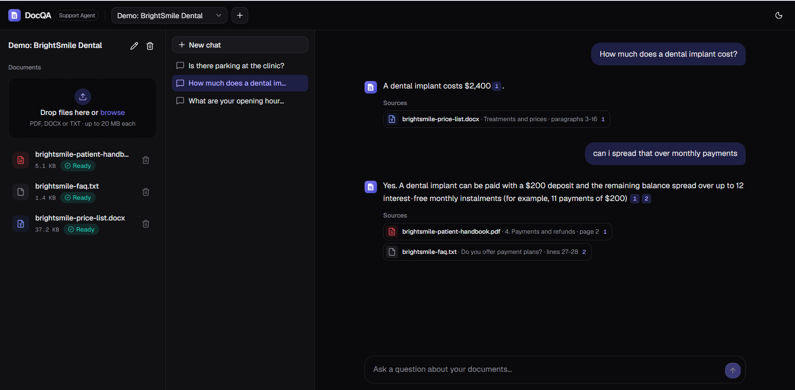
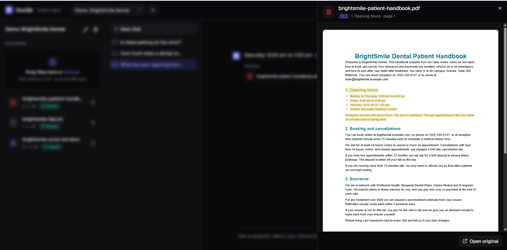
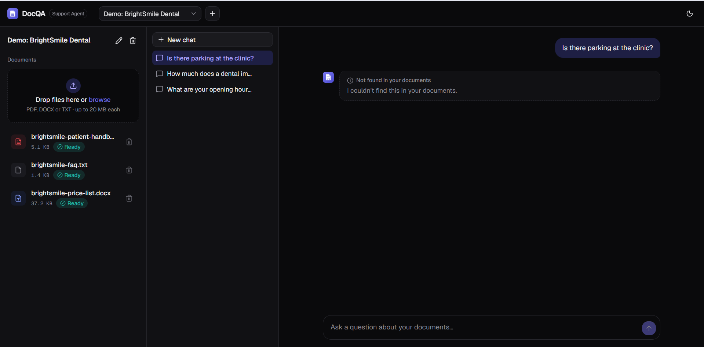
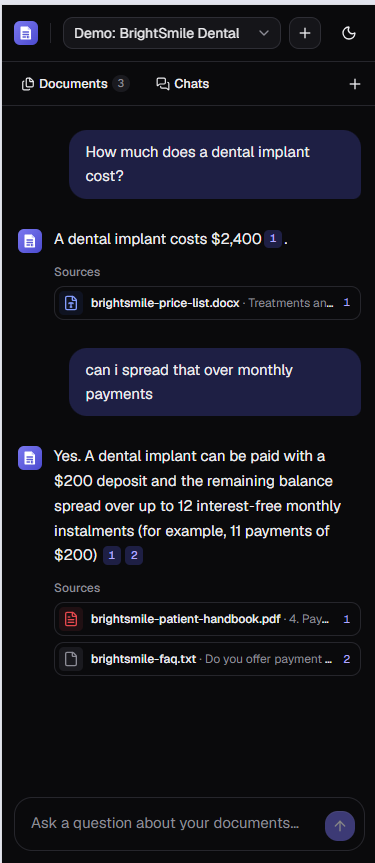
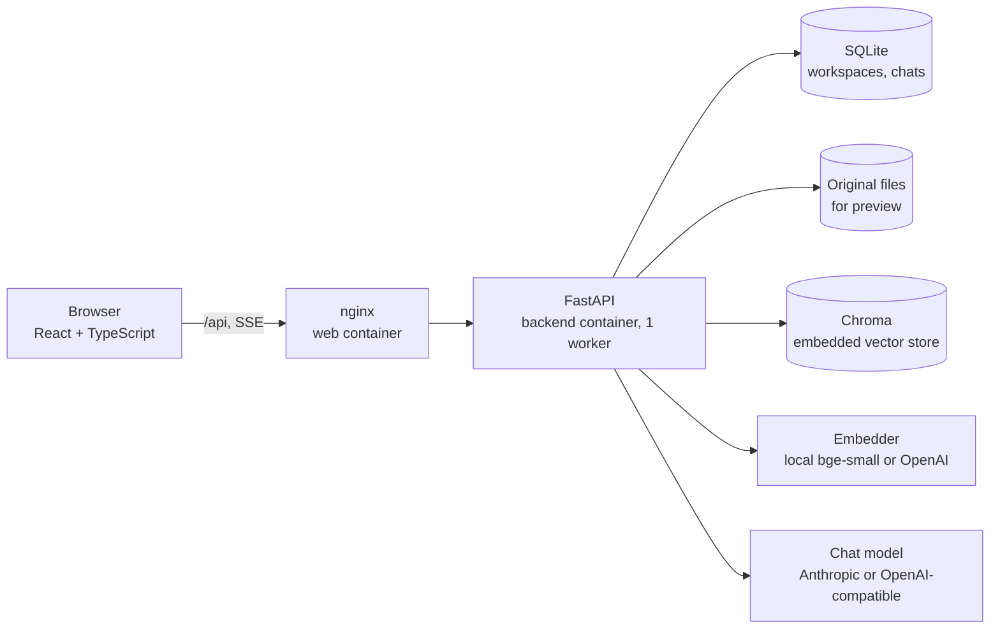
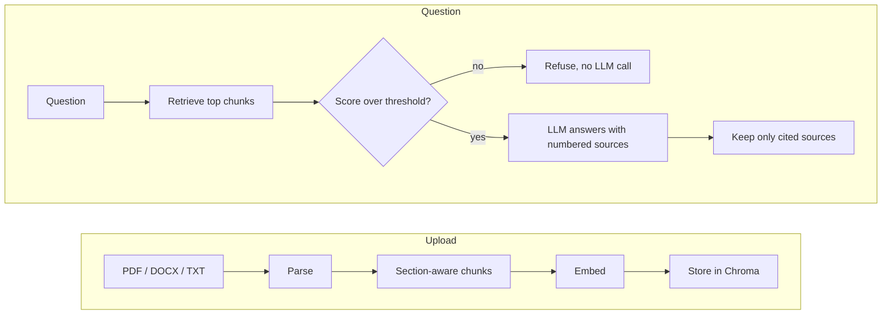

# DocQA Support Agent

An AI support agent that answers customer questions **only from a business's own documents**, with citations to the exact file, page, section or lines, and says so when the answer isn't there.

<!-- Badges: add once the repo is on GitHub
[](https://github.com/<user>/<repo>/actions/workflows/ci.yml)
-->

## Screenshots

<!-- Replace each placeholder with an image (docs/screenshots/*.png) or GIF. -->

| | |
| --- | --- |
|  <br> *TODO: a streamed answer with citation chips and the source list.* |  <br> *TODO: the side panel open on a PDF page with the cited passage highlighted.* |
|  <br> *TODO: a question the documents can't answer, showing the "not found" reply.* |  <br> *TODO: the layout on a 375 px phone.* |

<!-- Demo GIF (60-90 s, script in docs/DEMO.md):  -->

## Features

- Upload PDF, DOCX and TXT files into separate workspaces (one per business)
- Streamed answers grounded in those documents, with follow-up questions and saved chat history
- Citations name the file and page (PDF), section and paragraphs (DOCX) or lines (TXT); click one to preview the passage in the original
- Replies "I couldn't find that in the documents" instead of guessing
- Anthropic or OpenAI-compatible chat models (including Groq) and local or OpenAI embeddings, each chosen with one environment variable
- Public-demo mode: no login, private per-visitor workspaces, rate limits and a daily spend cap
- Responsive, light/dark UI

**Planned for Stage 2:** tool calling (book appointments, create support tickets) and an embeddable chat widget for any website.

## Architecture



How a document becomes an answer:



## Key engineering decisions

| Decision | Why |
| --- | --- |
| **Section-aware chunking**: a heading's section stays in one chunk and is split into token windows only when too long | Answers and citations land on a whole policy or price table, not half of one |
| **Citations**: sources are numbered `[n]` in the prompt, only cited ones come back, and they are renumbered 1, 2, 3 by first use | Every claim can be checked against the exact place it came from, and invented citations are dropped |
| **Similarity threshold plus an LLM refusal rule** (`RAG_MIN_SCORE`) | Off-topic questions cost no LLM call, and the model's rule catches in-domain questions the documents don't cover |
| **Visitor ownership without login** (`X-Visitor-Id`, stored only as a SHA-256; other people's items return 404) | A public demo where visitors can't see each other's uploads, with no sign-up friction (`PUBLIC_DEMO=true` only) |
| **In-process rate limits and a daily token cap** instead of a rate-limit library | One worker means in-memory is correct, it avoids extra dependencies, and the cap keeps a free-tier key from being drained (`PUBLIC_DEMO=true` only) |
| **CPU-only Docker for a 2 GB VPS**: CPU torch, the model baked into the image, one uvicorn worker, embedded Chroma | No multi-GB GPU packages, no model download at start-up, and two containers that fit in 2 GB |
| **Provider interfaces with fake implementations** | The whole test suite runs without API keys or network, so CI needs no secrets |
| **pypdf instead of PyMuPDF** | BSD-licensed, so clients can reuse the code without AGPL obligations |

## Quality

An eval over the demo clinic's three documents (PDF handbook, DOCX price list, TXT FAQ) with 34 golden questions in [`backend/eval/golden.toml`](backend/eval/golden.toml). The questions are answerable (half paraphrased the way patients type, with synonyms and typos), follow-ups, unanswerable (off-topic, and clinic questions the documents don't cover) and Arabic, Spanish and French. Scoring uses plain checks, not an LLM judge. Each run is saved in `backend/eval/results/` and compared with the previous one.

```bash
cd backend
uv run python -m eval.retrieval      # free: no LLM calls
uv run python -m eval.answers        # token estimate only
uv run python -m eval.answers --run  # real LLM, small subset, 60 s apart for Groq's free tier
```

**Retrieval** (bge-small, 21 chunks; hit@k = the right section is in the top k):

| Questions | n | hit@1 | hit@3 | hit@6 |
| --- | --- | --- | --- | --- |
| English, literal wording | 8 | 88% | 100% | 100% |
| English, paraphrased | 8 | 50% | 88% | 100% |
| Follow-ups, condensed | 4 | 100% | 100% | 100% |
| Follow-ups, as typed | 4 | 75% | 75% | 100% |
| Arabic / Spanish / French | 2 each | 0% | 50% | 50% / 100% / 50% |

**Answers** (gpt-oss-120b on Groq, 8 questions, 9,185 tokens): 5/5 answerable questions correct with the expected fact and a citation to the right section, 3/3 unanswerable ones refused, and no uncited answers.

**Refusal threshold.** `RAG_MIN_SCORE` stays at 0.45. English answerable questions score at least 0.559 and off-topic ones at most 0.461, so 0.51 would split that gap. But the off-topic side rests on only 4 questions, and 0.51 would refuse 4 of 6 non-English questions before the LLM sees them (2 of those had the right section retrieved). An off-topic question that gets past 0.45 costs one LLM call, and the model still refuses it: in the run above, the weather question did exactly that. Clinic questions the documents don't cover (parking scores 0.687) can't be stopped by any threshold, so the model's refusal rule handles them.

**Known gap: non-English questions.** The default local embedder is English-only. The cheapest fix is `EMBEDDING_PROVIDER=openai`, which is already supported. `intfloat/multilingual-e5-small` (MIT) would run locally, but it roughly doubles the backend's memory, and every workspace would have to be re-indexed and the threshold re-checked.

## Run locally

Requirements: Python 3.12, [uv](https://docs.astral.sh/uv/), Node 20.19+ or 22.12+ (required by Vite 8).

### One command (Windows PowerShell)

After the one-time setup below (`.env`, `uv sync`, `npm install`), run this from the repo root:

```powershell
powershell -ExecutionPolicy Bypass -File scripts\dev.ps1
```

It starts the backend and the frontend in their own windows, waits until the API is up, and seeds the **Demo: BrightSmile Dental** workspace with sample documents (it is safe to run again: nothing is duplicated). Then open http://localhost:5173. Press Ctrl+C in the script's window to stop both servers, or close a server's window to stop that server. [docs/DEMO.md](docs/DEMO.md) has a short demo recording script.

### Step by step

Backend (first terminal):

```bash
cd backend
cp .env.example .env   # then fill in your API key
uv sync
uv run pytest
uv run uvicorn app.main:create_app --factory --port 8000 --reload   # --reload restarts on code changes (development only)
```

Frontend (second terminal):

```bash
cd frontend
npm install
npm run test
npm run dev            # http://localhost:5173, proxies /api to the backend on :8000
```

Demo workspace (with the backend running):

```bash
cd backend
uv run python -m scripts.seed_demo
```

## Run with Docker

Production-style: two containers sized for a 2 GB server. `backend` runs FastAPI with embedded Chroma and the bge-small model baked into the image, and `web` runs nginx, which serves the built React app and proxies `/api` with streaming unbuffered. Requirements: Docker with Compose v2.

```bash
cp backend/.env.example backend/.env    # then fill in your API key and ADMIN_API_KEY (the only file you need to edit)
docker compose up -d --build            # first build downloads CPU-only PyTorch and the model: several minutes
docker compose exec backend python -m scripts.seed_demo --api-url http://127.0.0.1:8000 --ui-url http://127.0.0.1:8080
```

Open http://127.0.0.1:8080.

- **Data** (SQLite, the Chroma index and uploaded files) lives in the named volume `docqa_backend-data`. `docker compose down` followed by `docker compose up -d` keeps it, and `docker compose down -v` deletes it.
- **Secrets** come only from `backend/.env` at runtime (`env_file`). `.dockerignore` keeps `.env` out of both images.
- **Memory:** the limits are 1200 MB for the backend and 64 MB for web. Measured: the backend uses about 230 MB idle, 600-780 MB once the embedding model is loaded and indexing, and web about 15 MB.
- **Low-memory option:** set `EMBEDDING_PROVIDER=openai` in `backend/.env` (needs `OPENAI_API_KEY`). The local model and PyTorch are then never loaded, so the backend stays at a few hundred MB. Existing documents need a re-index after switching.
- **One worker on purpose:** SQLite, embedded Chroma, the model lock and the one-reply-per-conversation guard all live in a single process, so don't scale the backend to more than one worker or replica.
- Logs: `docker compose logs -f backend`. Stop: `docker compose down`.

### Public demo mode

The compose stack runs as a public, login-free demo (`PUBLIC_DEMO=true`). For a private client deployment, start it with `PUBLIC_DEMO=false docker compose up -d` and none of the following applies. Local development (`scripts\dev.ps1`) reads `PUBLIC_DEMO` from `backend/.env`, where it is `false` by default.

- **No login, but private:** the browser makes a random visitor id (`crypto.randomUUID()`, kept in localStorage) and sends it as `X-Visitor-Id`. The server stores only its SHA-256. Each visitor sees their own workspaces and chats, plus the seeded demo workspace, and gets a 404 for anyone else's (so ids can't be probed).
- **Read-only demo workspace:** visitors can chat in it, but uploading, deleting, renaming and reindexing get a 403, and the UI hides those controls. The seed sends `ADMIN_API_KEY` as `X-Admin-Key` to manage it, so set that key in `backend/.env` first.
- **Temporary workspaces:** visitor workspaces are deleted 24 h after they are created (`VISITOR_WORKSPACE_TTL_HOURS`), and so are visitors' chats in the demo workspace. An asyncio task in the app sweeps every 10 minutes and once at startup. That works because there is exactly one uvicorn worker, so there is exactly one sweeper. Expired workspaces return 404 right away, so the sweep only frees disk.
- **Limits, per client IP** (the IP nginx saw; uvicorn trusts `X-Forwarded-For` only from the compose network): questions per minute and per day, uploads per hour, new chats per hour, and new workspaces per 24 h. Over a limit, the API answers 429 with `Retry-After`, and the UI shows the wait. Limits are kept in memory, so a restart resets them.
- **Caps:** documents per workspace, total upload storage, and the sections per document (checked before anything is embedded). There is also a **daily LLM token cap** (`DAILY_TOKEN_CAP`, 150K by default, below Groq's free 200K/day). Once it's reached, questions get "The demo has reached its daily question limit" until midnight UTC, without calling the LLM. A provider's own 429 shows as "The assistant is busy".

Every limit is set in `backend/.env.example`, and 0 turns one off.

## Configuration

Everything is configured with environment variables in `backend/.env` (copy `backend/.env.example`, which documents every setting). The main ones:

| Variable | Default | Purpose |
| --- | --- | --- |
| `LLM_PROVIDER` | `anthropic` | `anthropic` or `openai` (also any OpenAI-compatible API through `OPENAI_BASE_URL`, such as Groq) |
| `ANTHROPIC_API_KEY` / `OPENAI_API_KEY` | empty | Only the selected provider's key is required |
| `EMBEDDING_PROVIDER` | `local` | `local` (bge-small on CPU, free) or `openai` (low memory) |
| `RAG_MIN_SCORE` | `0.45` | Similarity a chunk needs to count as relevant; below it the app refuses without calling the LLM |
| `MAX_UPLOAD_MB` | `20` | Largest accepted upload (the reverse proxy should enforce it too) |
| `PUBLIC_DEMO` | `false` | Turns on visitor ownership, the read-only demo workspace, expiry, rate limits and the token cap |
| `ADMIN_API_KEY` | empty | Needed to seed the read-only demo workspace in public-demo mode |
| `DAILY_TOKEN_CAP` | `150000` | Most LLM tokens per UTC day in public-demo mode |

The frontend needs no configuration in development (`frontend/.env.example` explains `VITE_API_BASE_URL`).

## Known limitations

- **English-only embeddings by default.** Non-English questions often retrieve the wrong section (see [Quality](#quality)). `EMBEDDING_PROVIDER=openai` is the cheapest fix.
- **PDF headings are detected from fonts.** Headings set larger or bold are found. Fake bold (outlined text) and headings that look like body text are not, and a PDF with one font size and weight becomes a single section, so its citations only name the page.
- **No OCR:** scanned, image-only PDFs are rejected with a clear message.
- **One backend worker by design** (SQLite, embedded Chroma and the in-process guards). Scaling out means replacing those first.
- **Rate limits live in memory,** so a restart resets them.

## Tech stack

| Layer | Choice |
| --- | --- |
| API | Python 3.12, FastAPI |
| Retrieval | ChromaDB, sentence-transformers or OpenAI embeddings |
| LLM | Anthropic or OpenAI-compatible (`LLM_PROVIDER`) |
| Frontend | React, TypeScript, Vite, Tailwind CSS, shadcn/ui, TanStack Query |
| Tests and CI | pytest, Vitest, ruff, pyright, ESLint, GitHub Actions |
| Deploy | Docker Compose |

## Project layout

```
backend/    FastAPI app, tests, eval, demo documents (demo_data/) and their scripts (scripts/)
frontend/   React app
scripts/    dev.ps1: start everything locally and seed the demo
docs/       plan and demo script
.github/    CI workflow
```

## Licence

[MIT](LICENSE)
